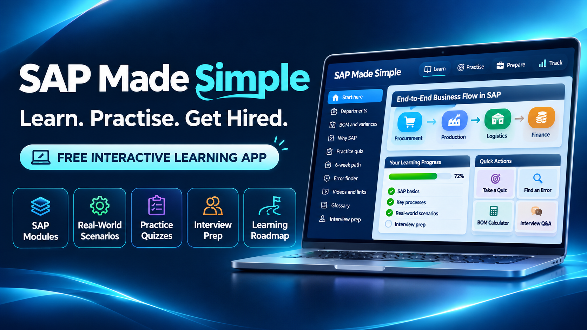

# SAP Made Simple — v2.0

**Learn. Practise. Get Hired.** A free, independent SAP learning hub built for students, operations professionals, consultants and job seekers.

## New in v2.0

- Modern, responsive learning dashboard with progress stats and quick actions
- Cross-content search for modules, T-codes, error messages and SAP terms
- Six interactive troubleshooting and business process case studies
- Flashcards for SAP terminology and transaction codes
- Dedicated T-code finder by department or keyword
- Private personal study notes with text export
- Local learning progress saved across page reloads (per browser/device)
- JSON export for a progress backup, reset button and privacy messaging
- Improved homepage, metadata, and independent SAP trademark disclaimer

## Retained capabilities

Department learning guides; SAP basics, S/4HANA/Fiori, MM, SD, PP, QM, PM, finance and supply chain; BOM variance calculator; learning quiz; interview preparation; six-week curriculum; SAP error finder; glossary and learning links.

## Getting started

1. Open `index.html` locally to try it.
2. To publish on GitHub Pages, upload the files in this folder to the repository root.
3. GitHub repository **Settings → Pages → Deploy from a branch → main → /(root)**.
4. Open the Pages URL generated by GitHub. For a project repository, it usually takes the form `https://YOUR-USERNAME.github.io/sap-made-simple/`. Replace the placeholder with the real username.

No backend, API key, build step, or paid hosting is needed. The optional Google Fonts stylesheet needs an internet connection; the app falls back to system fonts.

## Notes, scoring and privacy

This is a self-assessment tool, **not** an official SAP certification or a live SAP transaction simulator. Quiz scoring measures answers to the included questions, not verified job readiness. The calculator's 2% threshold is an example, not a universal accounting control. Some legacy and S/4HANA processes differ by SAP product version, modules and configuration. Validate transaction codes and interventions in official documentation and an authorised training environment.

Learning progress and notes are stored in the browser's localStorage. They are not synchronised to other devices. Do not enter confidential employer/customer information. Export notes regularly.

## Contributing and reporting issues

Use GitHub Issues for corrections and feature suggestions. Contributions and feedback are welcome.

## About the builder

Created by **VB (Venkateswararao Banday)**. LinkedIn: https://www.linkedin.com/in/venkateswararao-banday

## License and trademarks

MIT License (see `LICENSE`). This is an independent educational resource, not affiliated with SAP SE. SAP names and logos remain the property of their respective owners.
